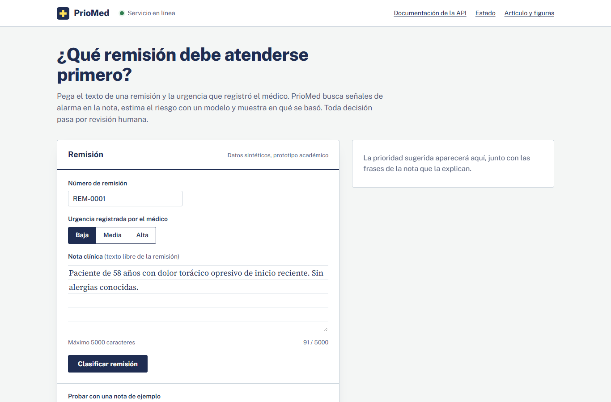
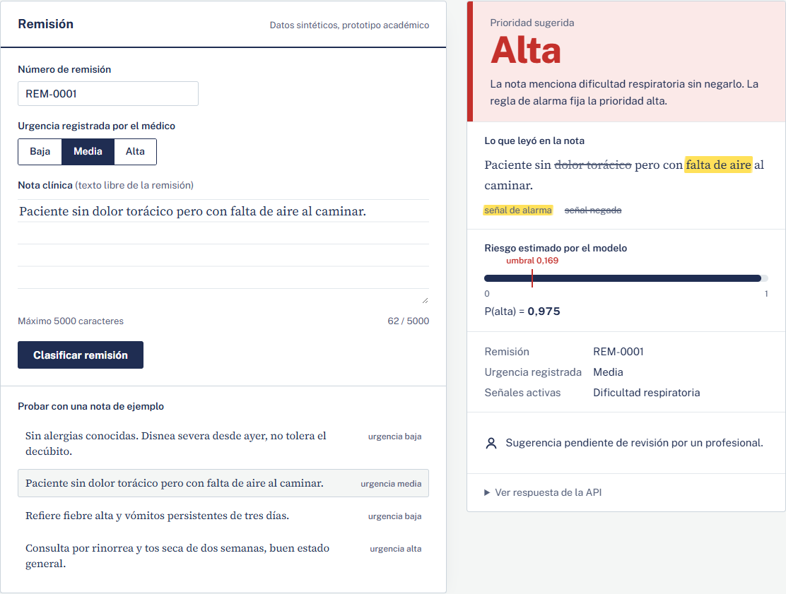
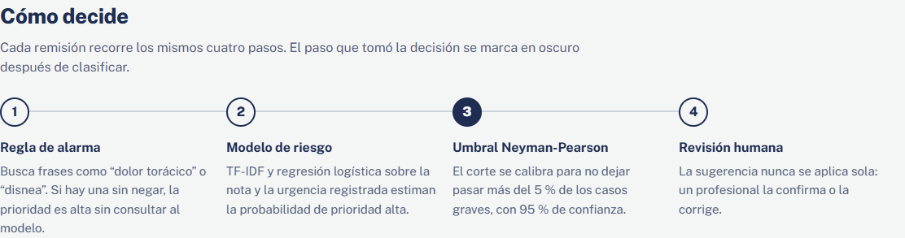
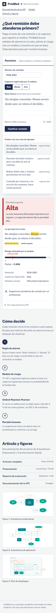

# priomed-infra

Infraestructura de PrioMed (Figura 3 del artículo) y portal web del prototipo.

- `docker-compose.yml`: servicio de clasificación + PostgreSQL + Redis. Los puertos se publican
  solo en `127.0.0.1`. Local: `cp .env.example .env && docker compose up --build`
- `deploy/`: despliegue en una sola instancia EC2 (Amazon Linux 2023) detrás de Apache httpd.
  - `deploy-ec2.sh`: instala swap, Docker compose/buildx y httpd, genera `.env` con contraseña
    aleatoria, recalcula los orígenes CORS con la IP actual, levanta los contenedores, publica el
    portal y la documentación, y configura el proxy. Es idempotente.
  - `priomed-httpd.conf`: VirtualHost propio seleccionado por nombre
    (`priomed.<IP>.nip.io` / `priomed.<IP>.sslip.io`), para convivir con otros sitios del servidor.
  - `web/index.html`: portal web (ver abajo). Un solo archivo HTML, sin dependencias de build.
- `docs/capturas/`: capturas del portal desplegado.
- `terraform/`: **esqueleto sin validar** de la VPC, subredes pública/privadas, RDS, S3, SQS y
  Secrets Manager. Falta: ALB, Auto Scaling de EC2, ElastiCache, NAT y VPC Endpoints. En AWS Academy
  Learner Lab varios servicios/roles IAM están restringidos; ajústalo a lo permitido.

## Portal web

El portal permite clasificar una remisión y ver en qué se basó la sugerencia. Llama a la API del
servicio de clasificación en el mismo origen (`/health`, `/classify`), así que no necesita CORS.



**Hoja de remisión.** Número de remisión, urgencia registrada por el médico (Baja / Media / Alta) y
nota clínica en texto libre, con contador de caracteres (máximo 5000). Incluye cuatro notas de
ejemplo que se clasifican con un clic. Los campos vacíos muestran un mensaje que dice qué falta.

**Panel de decisión.** Muestra la prioridad sugerida en colores de triage (rojo alta, ámbar media,
verde baja) y una frase que explica la decisión. Debajo:

- la nota tal como la leyó el servicio: frases de alarma activas resaltadas en amarillo y frases
  negadas tachadas (usa el campo `evidence` de la respuesta de `/classify`);
- el riesgo estimado por el modelo, P(alta), frente al umbral Neyman-Pearson (`high_threshold`);
- la remisión, la urgencia registrada, las señales activas y el aviso de revisión humana;
- un desplegable con la respuesta JSON de la API.



**Cómo decide.** Explica los cuatro pasos (regla de alarma, modelo de riesgo, umbral
Neyman-Pearson, revisión humana) y marca el paso que tomó la última decisión.



**Artículo y figuras.** Descarga del artículo (.docx), la presentación (.pptx), el reporte de
evaluación y las figuras 1 a 3, copiados de `priomed-docs` durante el despliegue.

Diseño: tipografías Public Sans (interfaz) y Source Serif 4 (texto de la nota), cargadas desde
Google Fonts con respaldo a fuentes del sistema. Se adapta a tablet y móvil, mantiene el foco
visible con teclado y respeta `prefers-reduced-motion`.



## Despliegue en EC2

```bash
# Desde el equipo local, con los tres repos como carpetas hermanas
tar --exclude=.git -czf priomed.tgz priomed-classification-service priomed-infra priomed-docs
scp -i Llave.pem priomed.tgz ec2-user@<IP>:/tmp/
ssh -i Llave.pem ec2-user@<IP> 'mkdir -p ~/priomed && tar -xzf /tmp/priomed.tgz -C ~/priomed \
  && bash ~/priomed/priomed-infra/deploy/deploy-ec2.sh'
```

Resultado: `http://priomed.<IP>.nip.io/` (portal) y `http://priomed.<IP>.nip.io/docs` (Swagger).
El security group solo necesita los puertos 22 y 80; 8000/5432/6379 quedan internos.
Si la IP pública de la instancia cambia (stop/start sin Elastic IP), vuelve a correr el script.

Para actualizar solo el portal sin reconstruir contenedores:

```bash
scp -i Llave.pem deploy/web/index.html ec2-user@<IP>:priomed/priomed-infra/deploy/web/
ssh -i Llave.pem ec2-user@<IP> 'sudo cp ~/priomed/priomed-infra/deploy/web/index.html /var/www/priomed/'
```
